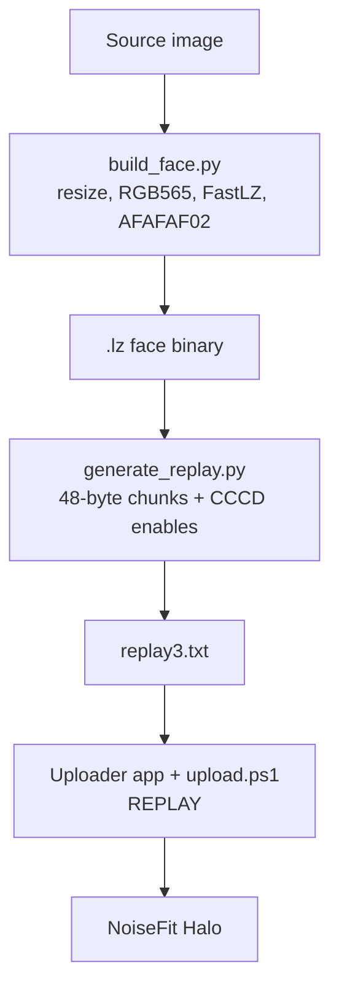

<div align="center">

# Approach Report

**How the NoiseFit Halo face transfer problem was investigated, what failed, and what finally worked.**


</div>

---

## Table of Contents

1. [Summary](#summary)
2. [Background and Goal](#background-and-goal)
3. [Phase 1: Investigating the Official App](#phase-1-investigating-the-official-app)
4. [Phase 2: Approaches That Did Not Work](#phase-2-approaches-that-did-not-work)
5. [Phase 3: Reverse-Engineering the Format and Protocol](#phase-3-reverse-engineering-the-format-and-protocol)
6. [Phase 4: The Working Solution](#phase-4-the-working-solution)
7. [Results](#results)
8. [Open Problems](#open-problems)
9. [Lessons Learned](#lessons-learned)
10. [Future Work](#future-work)

---

## Summary

The official NoiseFit app gates custom watchface uploads behind a paywall and relies on a closed native compiler. Rather than fight that compiler, this project went around it:

- The **face format** was reverse-engineered from real watchface files.
- The **BLE transfer protocol** was reverse-engineered from logcat and HCI captures.
- A **pure-Python builder** now produces the same container format, and a **replay mechanism** sends it to the watch.

The transport is verified end to end. Converting arbitrary images into faces that render correctly is only partially solved, and is the main remaining task.

## Background and Goal

**Goal:** generate valid watchface binaries offline, with no server calls, no root, and no dependence on the official compiler, then deliver them to a NoiseFit Halo over BLE.

**Constraints:**

- The official app and its native library cannot be modified and re-signed.
- No public documentation exists for the face container or the BLE handshake.
- The solution should work for someone with only a phone, if possible.

## Phase 1: Investigating the Official App

### What was done

- Decompiled the noiseFit APK to understand how the app calls the face compiler.
- Analysed `libVeryFitMulti.so` in Ghidra and IDA Pro.
- Located the native `makeFileCompression()` entry point and traced what it needs.

### What was found

The native compiler requires a full package directory in its working folder:

| Required item | Purpose               |
| ------------- | --------------------- |
| `iwf.json`    | Package configuration |
| `fonts/`      | Font bitmap data      |
| `preview/`    | Preview images        |

When these are missing, the call chain
`makeFileCompression()` -> `make_compression_file()` -> `bitmap_tool_get_font_buff()`
dereferences a null pointer at `0xdf` and the process dies with SIGSEGV.

The JSON the compiler expects looks like this:

```json
{
  "fileName": "/path/to/image",
  "endName": "/path/to/output.lz",
  "pic_num": 0,
  "format": 5
}
```

Format `5` corresponds to the RGB565 / `AFAFAF02` output.

### Outcome

The native library could not be used directly in a form that could be distributed, so this route was abandoned.

## Phase 2: Approaches That Did Not Work

### 1. Calling the native library directly

|              |                                                                                                                                                                                                                     |
| ------------ | ------------------------------------------------------------------------------------------------------------------------------------------------------------------------------------------------------------------- |
| **Idea**     | Call `makeFileCompression()` from Java or Kotlin with the JSON above                                                                                                                                                |
| **Problem**  | Crashes without the full package directory. Supplying placeholder `fonts/`, `iwf.json` and `preview/` does not help distribution, because modified app code cannot be re-signed in a way that keeps the app working |
| **Decision** | Abandoned                                                                                                                                                                                                           |

### 2. Rewriting FastLZ and the container in Java

|                    |                                                                                                                                                                |
| ------------------ | -------------------------------------------------------------------------------------------------------------------------------------------------------------- |
| **Idea**           | Port the compressor and the `AFAFAF02` container to Java so everything runs inside the APK                                                                     |
| **Estimated cost** | About two weeks of full-time work                                                                                                                              |
| **Risks**          | The FastLZ match search is pointer-heavy and must be reworked; one wrong header offset breaks the face; debugging on-device without easy logcat access is slow |
| **Decision**       | Rejected for now, since a working Python path already existed                                                                                                  |

### 3. Termux-only workflow

|                   |                                                                                                     |
| ----------------- | --------------------------------------------------------------------------------------------------- |
| **Idea**          | Run `build_face.py` directly on the phone                                                           |
| **Problem**       | `pkg install python` could not be completed over ADB; Termux has to be installed and set up by hand |
| **Current state** | Works once Termux is installed manually                                                             |
| **Decision**      | Kept as an optional path, not the primary one                                                       |

## Phase 3: Reverse-Engineering the Format and Protocol

### Extracting the face format

The `.lz` format was extracted from `watchface.zip` and real watchfaces, then compared byte for byte against output from the Python builder.

| Field             | Value                     | Description                         |
| ----------------- | ------------------------- | ----------------------------------- |
| Magic             | `afafaf02`                | 4-byte signature                    |
| Uncompressed size | `754368`                  | 466 x 466 x 2 bytes (RGB565)        |
| Block count       | `185`                     | Entries in the address table        |
| Address table     | 185 entries, 2 bytes each | Offsets into the compressed payload |
| Header size       | 396 bytes (observed)      | Remaining fields not fully mapped   |
| Payload           | Variable                  | FastLZ-compressed pixel data        |
| Trailer           | 4 bytes                   | CRC-32/MPEG-2 over the payload      |

CRC-32/MPEG-2 parameters: polynomial `0x04C11DB7`, init `0xFFFFFFFF`, no input or output reflection, no final XOR.

**Verification:** the Python builder produces headers whose magic, uncompressed size and block count are identical to a real face. The compressed payload differs in size (the reference face is 49,887 bytes), but the watch accepts the structure.

### Reconstructing the BLE protocol

From logcat observations and HCI captures:

| Log observation                 | Meaning                               |
| ------------------------------- | ------------------------------------- |
| `replay start`                  | Transfer initiated                    |
| `#X wait 2A <- 000001010000...` | Chunk X written, waiting on the watch |
| `ack ok 000001010000`           | Watch acknowledged the write          |
| `> 2a 177B`                     | Watch sent a 177-byte notification    |
| `replay DONE`                   | Transfer completed                    |

**Replay script structure (`replay3.txt`):**

- Five CCCD enables to turn on notifications:
  `W 22 0100`, `W 25 0100`, `W 28 0100`, `W 2B 0100`, `W 2E 0100`
- Face data as 48-byte chunks: `W 2A <chunk>`, sent with `WRITE_TYPE_NO_RESPONSE` and padded if needed
- Wait markers: `R 24 000001010000`, which hold until the watch's 177-byte notification arrives

## Phase 4: The Working Solution

### Why the native library is no longer needed

The watch decoder checks the header (magic, uncompressed size, block count) and the shape of the compressed data. It has no way of knowing which tool produced the file. So `build_face.py` generates the same container itself, and the crashing native library is never invoked.

### Pipeline



### Three ways to use it

| Path                   | What it involves                                                                                         | Time         | Status   |
| ---------------------- | -------------------------------------------------------------------------------------------------------- | ------------ | -------- |
| A: PC and BLE          | `main/builder/build_face.py`, then `main/builder/generate_replay.py`, then `main/scripts/upload.ps1`     | About 5 min  | Verified |
| B: Phone with Termux   | Install Termux manually, install Python and Pillow, run the builder scripts                              | About 10 min | Works    |
| C: Pre-generated faces | Select a face from `main/watchfaces/` (`face_solid.lz`, `face_gradient.lz`, `face_random.lz`) in the app | About 1 min  | Easiest  |

### Where things live

| Path                                                   | Purpose                                                      |
| ------------------------------------------------------ | ------------------------------------------------------------ |
| `main/builder/`                                        | Python face builder, replay generator, header verifier       |
| `main/scripts/`                                        | PowerShell helpers: upload, replay test, replay dump         |
| `main/watchfaces/`                                     | Pre-generated test faces                                     |
| `main/MainActivity.java`, `main/WFCompilerRunner.java` | Uploader app sources                                         |
| `Docs/`                                                | This report, HCI capture, extracted data, session transcript |
| `skills/jailbreak-noiseFit/skill.md`                   | Skill for reproducing the approach                           |
| `NoiseFit_Halo_uploader.apk`                           | Pre-built debug APK                                          |

## Results

| Component                         | Result                                                                         |
| --------------------------------- | ------------------------------------------------------------------------------ |
| Face header (magic, size, blocks) | Matches a real face                                                            |
| BLE replay                        | All writes acknowledged, 177-byte notifications received, `replay DONE` logged |
| Pre-generated faces               | All three transfer successfully                                                |
| Uploader app                      | Runs on Samsung SM-M336BU, Android 16                                          |
| `upload.ps1`                      | Disables NoiseFit, launches the app, monitors logcat for DONE or STALL         |
| Debug APK                         | Installs and runs                                                              |
| Arbitrary image to face           | Partial, see below                                                             |

### Approach outcomes at a glance

| Approach                             | Outcome                           | Decision         |
| ------------------------------------ | --------------------------------- | ---------------- |
| Native library, direct use           | Crashes without package directory | Abandoned        |
| Java rewrite of FastLZ and container | Roughly two weeks of work         | Rejected for now |
| Termux-only                          | Works after manual setup          | Optional         |
| Python builder plus BLE replay       | Transport verified                | Current solution |

## Open Problems

| Problem                                                                                                  | Why it matters                                                                   |
| -------------------------------------------------------------------------------------------------------- | -------------------------------------------------------------------------------- |
| Compressed sizes differ from the official compiler (14 KB to 442 KB versus 49,887 bytes for a real face) | Larger files take longer to send and suggest the block layout is not yet matched |
| Header layout beyond the three checked fields is not fully mapped                                        | Subtle fields may affect rendering on some images                                |
| Pixel fidelity for arbitrary photos is not fully confirmed                                               | The format is accepted, but correct rendering of every image is the real goal    |
| Only one watch and one phone tested                                                                      | Compatibility with other models is unknown                                       |
| Termux setup cannot be scripted over ADB                                                                 | The phone-only path stays manual                                                 |

## Lessons Learned

- **Do not fight the closed component if you can sidestep it.** Reproducing the output format was far cheaper than repairing the compiler.
- **Captures beat guesses.** Logcat and HCI logs gave the full BLE sequence without touching the watch firmware.
- **Header validation is a gift.** The watch checking only structure made it possible to iterate quickly with synthetic faces (solid, gradient, random) before tackling real images.
- **Separate the transport from the content.** Proving the BLE replay with known-good test faces isolated the remaining problem to the converter.

## Future Work

| Improvement                                                   | Effort | Impact                            |
| ------------------------------------------------------------- | ------ | --------------------------------- |
| Finish mapping the header and match the official block layout | High   | Smaller files, higher fidelity    |
| Preview renderer for `.lz` files                              | Medium | Catch bad output before sending   |
| Automated Termux setup                                        | Medium | Smoother phone-only path          |
| Cross-platform upload script                                  | Low    | Removes the PowerShell dependency |
| GUI for the face builder                                      | High   | Easier for non-technical users    |
| Support for other NoiseFit models and resolutions             | High   | Wider compatibility               |

---

<div align="center">

Report generated: October 31, 2026
Repository: `NoiseFit_Halo_Face_Builder` | See also: [README](../README.md), [llms.txt](../llms.txt), [skill](../skills/jailbreak-noiseFit/skill.md)
Reverse-engineered from `libVeryFitMulti.so`, `watchface.zip` and the uploader APK

</div>
