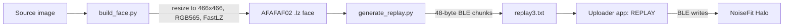

<div align="center">

# NoiseFit Halo Face Builder

**Build custom watchfaces and send them to a NoiseFit Halo over Bluetooth LE, completely offline and without the in-app paywall.**

<br>


<br>


</div>

---

## Table of Contents

1. [What This Project Is](#what-this-project-is)
2. [Purpose](#purpose)
3. [Problem Statement](#problem-statement)
4. [How It Works](#how-it-works)
5. [Current Status](#current-status)
6. [Repository Layout](#repository-layout)
7. [Getting Started](#getting-started)
8. [Pre-Generated Faces](#pre-generated-faces)
9. [Technical Notes](#technical-notes)
10. [Known Limitations](#known-limitations)
11. [Roadmap and Help Wanted](#roadmap-and-help-wanted)
12. [Troubleshooting](#troubleshooting)
13. [Contributing](#contributing)
14. [Disclaimer](#disclaimer)

**More documentation:**
[Approach report](Docs/APPROACHES_REPORT.md) |
[AI assistant context](llms.txt) |
[Setup and porting skill](skills/jailbreak-noiseFit/skill.md)

---

## What This Project Is

NoiseFit Halo Face Builder is a reverse-engineering project that reproduces how the official NoiseFit app sends watchfaces to a NoiseFit Halo smartwatch.

It has two halves:

- **A face builder** (Python) that takes an ordinary image and tries to turn it into the binary watchface format the watch understands (an `AFAFAF02` container holding compressed RGB565 pixel data).
- **A BLE uploader** (Android app plus helper scripts) that replays the same Bluetooth Low Energy write sequence the official app uses, so the watch accepts the face as if it came from NoiseFit.

Everything runs locally. No account, no server, no root access.

## Purpose

The goal is simple: **your watch should display the faces you want**, not only the ones the app decides to unlock for you.

This project exists to:

- Document how NoiseFit transfers custom and premium faces to the watch, so the process is understood rather than a black box.
- Let owners upload their own designs to hardware they own.
- Provide an open, offline alternative to the paywalled in-app face flow.
- Serve as a reference for anyone working on similar Veryfit-family watch protocols.

## Problem Statement

Custom watchface upload in the NoiseFit app sits behind a paywall, and the process is tied to the vendor's servers. In practice that means:

1. **You cannot send your own image to your own watch** without going through the app's gated flow.
2. **The face compiler is a closed native library** (`libVeryFitMulti.so`). It is fragile: it crashes with a null pointer dereference unless a full package directory (`iwf.json`, `fonts/`, `preview/`) is present, and it cannot be patched because a modified APK cannot be re-signed in a way the app accepts.
3. **The transfer protocol is undocumented.** There is no public description of the face container format or of the BLE handshake used to push it.

So the work breaks down into two sub-problems:

| Sub-problem | Question                                                                 | Result                       |
| ----------- | ------------------------------------------------------------------------ | ---------------------------- |
| Transport   | Can we make the watch accept a face over BLE without the official app?   | Yes, verified                |
| Conversion  | Can we turn any arbitrary image into a face the watch renders correctly? | Partially, still in progress |

## How It Works



**Step by step**

1. `build_face.py` resizes the image to 466 x 466, converts it to RGB565, compresses it with a FastLZ-style compressor, and wraps it in the `AFAFAF02` container (header, address table, payload, CRC trailer).
2. `generate_replay.py` slices the finished `.lz` into 48-byte chunks and emits `replay3.txt`, a script of BLE operations (enable notifications, write chunks, wait for acknowledgements).
3. The uploader app (`com.jay.wfup`) connects to the watch by MAC address and plays that script back with the REPLAY button.
4. The watch acknowledges each stage, and the log ends with `replay DONE`.

**Why the native library is not needed**

The watch only validates the container header and the structure of the compressed data. It does not care how the file was produced. The Python builder generates the same container independently, so the crashing native compiler is never called.

## Current Status

| Area                      | State               | Notes                                                                                                                                  |
| ------------------------- | ------------------- | -------------------------------------------------------------------------------------------------------------------------------------- |
| BLE connection and replay | Verified            | All writes acknowledged, watch returns the expected 177-byte notifications, log ends in `replay DONE`                                  |
| Container header          | Verified            | Magic, uncompressed size and block count match a real `watchface.zip` face                                                             |
| Pre-generated test faces  | Working             | Solid, gradient and random faces transfer successfully                                                                                 |
| Arbitrary image to face   | Partial             | Header is correct, but compressed output differs from the official compressor and rendering of arbitrary photos is still being refined |
| Compression efficiency    | Needs work          | Official face is 49,887 bytes; ours ranges widely depending on content                                                                 |
| On-phone build (Termux)   | Works, manual setup | Termux must be installed by hand                                                                                                       |
| Standalone Java compiler  | Not started         | Considered, deprioritised                                                                                                              |

Tested on a Samsung SM-M336BU running Android 16 with a NoiseFit Halo.

## Repository Layout

```
NoiseFit_Halo_Face_Builder/
├── Docs/
│   ├── APPROACHES_REPORT.md        Full write-up of what was tried and learned
│   ├── btsnoop_hci.log             Raw HCI capture of a real transfer
│   ├── extracted_FS_data_log_bt_btsnoop_hci.log
│   └── wf_transcript.txt           Session transcript of write sequences
├── main/
│   ├── builder/
│   │   ├── build_face.py           Image -> RGB565 -> FastLZ -> AFAFAF02 .lz
│   │   ├── generate_replay.py      .lz -> replay3.txt (48-byte BLE chunks)
│   │   └── verify_build.py         Checks a built .lz against expected header values
│   ├── scripts/
│   │   ├── dump_replay.ps1         Dumps replay data (see script header)
│   │   ├── test_replay.ps1         Original replay test reference
│   │   └── upload.ps1              Disables NoiseFit, launches app, watches logcat
│   ├── watchfaces/
│   │   ├── face_solid.lz           Pre-generated solid face (14,848 bytes)
│   │   ├── face_gradient.lz        Pre-generated gradient face (141,084 bytes)
│   │   └── face_random.lz          Pre-generated random face (442,353 bytes)
│   ├── MainActivity.java           Uploader app: BLE connection, REPLAY, MAC input
│   └── WFCompilerRunner.java       Compiler runner with package-directory fix
├── skills/
│   └── jailbreak-noiseFit/
│       └── skill.md                Skill for AI assistants: setup and porting guide
├── llms.txt                        Context file for AI assistants
├── NoiseFit_Halo_uploader.apk      Pre-built debug APK
├── project.toml                    Project metadata
└── README.md
```

## Getting Started

### Prerequisites

- A NoiseFit Halo watch, already paired once with the NoiseFit app so you know its MAC address
- An Android phone (Android 12 or newer recommended for BLE permissions)
- For the PC route: Python 3, Pillow, ADB, and PowerShell
- USB debugging enabled on the phone

### 1. Install the uploader app

```bash
adb install NoiseFit_Halo_uploader.apk
```

This installs `com.jay.wfup`. The app provides MAC input, a REPLAY button, and a TEST COMPILER button (the latter crashes by design on the stock native library; you do not need it).

To build from source, the uploader's Java sources (`MainActivity.java`,
`WFCompilerRunner.java`) are in `main/`. Add them to an Android Studio project
with BLE permissions, then run Build > Build APK(s).

### 2. Pick a workflow

#### Workflow A: PC and BLE (most reliable)

```bash
pip install pillow

# Build a face from your image
python main/builder/build_face.py input_image.png face.lz

# Optional: sanity-check the header
python main/builder/verify_build.py face.lz

# Generate the BLE replay script
python main/builder/generate_replay.py

# Launch the upload helper
.\main\scripts\upload.ps1
```

Then in the app: enter your watch MAC, press **REPLAY**, and wait for `replay DONE` in logcat.

#### Workflow B: Phone only with Termux

Install Termux manually (the ADB route for `pkg install` is unreliable), then:

```bash
python main/builder/build_face.py /sdcard/DCIM/Camera/photo.jpg face.lz
python main/builder/generate_replay.py
```

Open the uploader app, enter the MAC, and press REPLAY.

#### Workflow C: No build at all

Use one of the pre-generated faces below. Install the APK, enter the MAC, pick a face, press REPLAY.

### 3. Find your watch MAC

Check the NoiseFit app's device screen, your phone's Bluetooth settings under the watch's details, or scan with a BLE scanner app. Use your own address; do not reuse anyone else's.

## Pre-Generated Faces

| `main/watchfaces/face_solid.lz` | 14,848 bytes | Single flat color, the most compressible case |
| `main/watchfaces/face_gradient.lz` | 141,084 bytes | Smooth color gradient |
| `main/watchfaces/face_random.lz` | 442,353 bytes | Random pixels, the least compressible case |

All three carry the expected header: magic `afafaf02`, uncompressed size `754368`, block count `185`.

## Technical Notes

### Face container (`.lz`)

| Field             | Value                     | Meaning                             |
| ----------------- | ------------------------- | ----------------------------------- |
| Magic             | `afafaf02`                | 4-byte signature                    |
| Uncompressed size | `754368`                  | 466 x 466 pixels x 2 bytes (RGB565) |
| Block count       | `185`                     | Entries in the address table        |
| Address table     | 185 entries, 2 bytes each | Offsets into the compressed payload |
| Payload           | Variable                  | FastLZ-compressed pixel data        |
| Trailer           | 4 bytes                   | CRC-32/MPEG-2 over the payload      |

Observed header size is 396 bytes. The exact layout of the remaining header fields is still being mapped.

> CRC-32/MPEG-2 uses polynomial `0x04C11DB7`, initial value `0xFFFFFFFF`, no bit reflection and no final XOR.

### BLE replay sequence

The replay script, observed from logcat and HCI captures:

1. Enable notifications on five characteristics:
   `W 22 0100`, `W 25 0100`, `W 28 0100`, `W 2B 0100`, `W 2E 0100`
2. Write face data as 48-byte chunks to handle `2A` using `WRITE_TYPE_NO_RESPONSE`.
3. At sync points, wait for the watch (`R 24 000001010000`) to send a 177-byte notification on `2A` before continuing.
4. On success the log prints `replay DONE`.

Typical log markers:

| Log line                        | Meaning                            |
| ------------------------------- | ---------------------------------- |
| `replay start`                  | Transfer begun                     |
| `#X wait 2A <- 000001010000...` | Chunk X sent, waiting on the watch |
| `ack ok 000001010000`           | Watch acknowledged                 |
| `> 2a 177B`                     | 177-byte notification received     |
| `replay DONE`                   | Transfer completed                 |

### Inspecting captures

Open `Docs/btsnoop_hci.log` in Wireshark and filter for ATT writes to handle `0x002a` to see face chunks, or search the transcript for `ack ok`.

## Known Limitations

| Limitation                                     | Effect                                                                | Workaround                                                                 |
| ---------------------------------------------- | --------------------------------------------------------------------- | -------------------------------------------------------------------------- |
| Compression differs from the official compiler | Files can be far larger than the 49,887-byte reference face           | The watch accepts the format; work on a better compressor is ongoing       |
| Arbitrary photo fidelity not fully confirmed   | Some images may render incorrectly                                    | Test with the pre-generated faces first, compare against `verify_build.py` |
| Native compiler crash                          | TEST COMPILER button crashes without `fonts/`, `iwf.json`, `preview/` | Not needed; use the Python builder                                         |
| Termux setup                                   | Cannot be automated over ADB                                          | Install Termux manually, then run the `pkg` commands in-app                |
| Single device tested                           | Other Noise models are untested                                       | Reports welcome                                                            |
| Windows-centric tooling                        | `main/scripts/*.ps1` need PowerShell                                  | Use PowerShell on Linux/macOS or run the ADB commands by hand              |

## Roadmap and Help Wanted

The transport layer works. The open problem is **image conversion**, and that is where help is most useful.

- [ ] Fully decode the `AFAFAF02` header beyond magic, size and block count
- [ ] Understand how the official compressor chooses block boundaries so output sizes match
- [ ] Confirm pixel order, byte order and any per-block transforms for arbitrary images
- [ ] Add a preview renderer to check a `.lz` before sending it
- [ ] Cross-platform upload script (Bash) alongside `upload.ps1`
- [ ] Support other NoiseFit watch models and resolutions
- [ ] Optional: Java port of the builder so no PC or Termux is needed

If you have real `.lz` samples from a Halo, even a few, they would help enormously.

## Troubleshooting

**The app crashes when I press TEST COMPILER.**
Expected. That button calls the native library, which needs files this project deliberately bypasses.

**REPLAY stalls partway.**
Keep the phone close to the watch, make sure the official NoiseFit app is disabled or force-stopped (`upload.ps1` does this for you), and retry. Only one app can hold the BLE connection.

**The watch connects but shows a corrupted or blank face.**
Run `verify_build.py` on your `.lz`. If the header is fine, the problem is likely in pixel data, which is the known partial area. Try a pre-generated face to confirm the transport works.

**`pkg install` fails in Termux.**
Install Termux manually and run the commands inside the app rather than over ADB.

## Contributing

Pull requests and issues are welcome, especially for:

- the compressor and container layout
- additional watch models
- captures and sample `.lz` files
- documentation fixes

Please include logs or captures when reporting a transfer problem.

## Disclaimer

This is an independent, community research project. It is **not affiliated with, endorsed by, or supported by Noise or any related company.** "NoiseFit" and "Halo" are trademarks of their respective owners.

It is intended for interoperability and personal use with hardware you own. Use it with images and designs you created or are licensed to use. You are responsible for complying with the laws and terms of service that apply to you. The software is provided as is, with no warranty; uploading a malformed face to a watch carries some risk, so use it at your own discretion.

---

<div align="center">

Built with Python, Pillow, a FastLZ port, and a lot of logcat.
Reverse-engineered from `libVeryFitMulti.so`, `watchface.zip` and the uploader APK (`com.jay.wfup`).

Last updated: October 31, 2026

</div>
